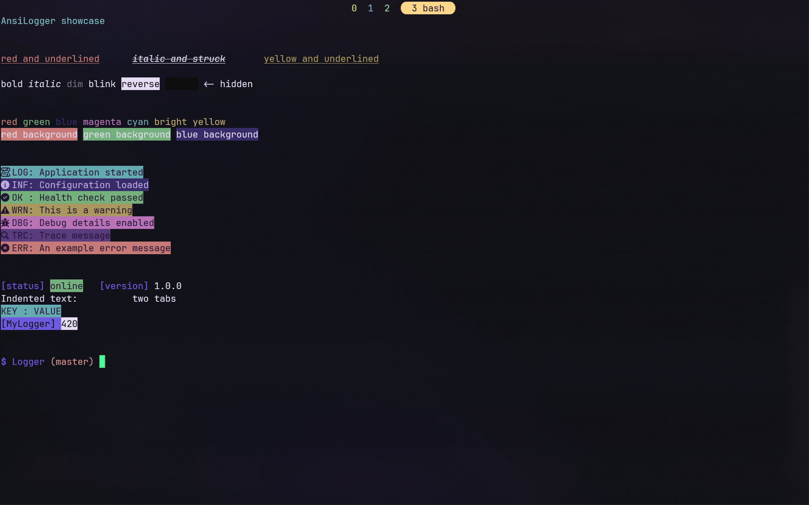

# AnsiLogger

AnsiLogger is a small C++ header-only logger for writing colorful and styled terminal output with ANSI escape sequences. It supports nested styles, foreground and background colors, log-level helpers, tags, spacing, tabs, and new lines.



## Usage

Include the modular header:

```cpp
#include "includes/AnsiLogger.hpp"
```

Or use the generated single-header version:

```cpp
#include "dist/AnsiLogger.single.hpp"
```

Basic example:

```cpp
#include "includes/AnsiLogger.hpp"

int main() {
    AnsiLogger logger;

    logger
        .underline(
            logger
                .red("red and underlined")
                .italic(logger.strike("italic and struck"))
                .yellow("yellow and underlined")
        )
        .new_line()
        .success("Everything is working")
        .to_cout();
}
```

Styles can be chained together:

```cpp
logger
    .red("red").space()
    .green("green").space()
    .blue("blue")
    .new_line()
    .to_cout();
```

Available log helpers include:

```cpp
logger.log("message");
logger.info("information");
logger.success("success");
logger.warning("warning");
logger.debug("debug details");
logger.trace("trace details");
logger.error("error");
```

`to_cout()` writes the formatted message to standard output. Use `to_string()` when the formatted result is needed as a `std::string`.

## Project layout

```text
includes/AnsiLogger.hpp       Main logger interface
includes/AnsiSequences.hpp    ANSI sequence definitions
dist/AnsiLogger.single.hpp    Generated standalone header
main.cpp                      Usage showcase
assets/example_vid.gif        Example output
```

The project has no runtime dependencies beyond the C++ standard library.
